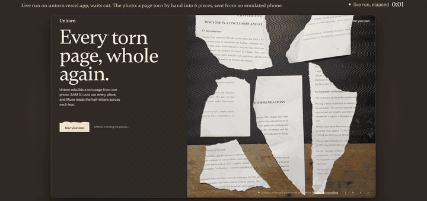
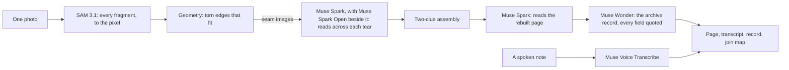
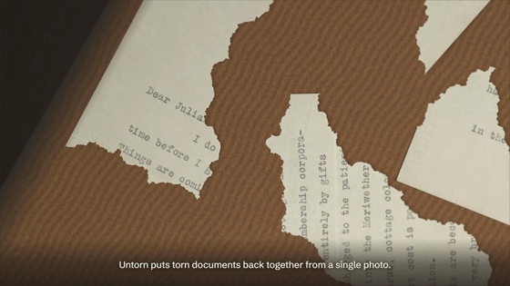

# Untorn

[](https://github.com/iamdflame/untorn/actions/workflows/ci.yml)

**Untorn puts torn documents back together from one photo.** Meta's SAM 3.1 cuts out every piece to the pixel, and Muse Spark reads the half-letters across each tear, like a crossword, to decide which pieces belong together. When a stack of pages is torn at once, the pieces share the very same edges and shape can't decide. Reading does.



*A page torn by hand into 6 pieces, one photo from a phone, rebuilt live on untorn.vercel.app (waits cut; the run took 55 s).*

**Try it:** [untorn.vercel.app](https://untorn.vercel.app/?for=judges) (free, no sign-up) · **Demo video:** [youtu.be/XT53dzF6VU8](https://youtu.be/XT53dzF6VU8) · **Accuracy:** [untorn.vercel.app/accuracy](https://untorn.vercel.app/accuracy) · **Verify it yourself:** [below](#verify-it-yourself)

*Meta Global AI Developer Hackathon 2026 · Indie Developer track · Theme: Push the Frontier · [For judges: the four criteria](#for-judges-the-four-criteria)*

## At a glance
- **Real paper:** a printed page torn by hand into 6 pieces came back whole in **5 of 5** live runs on the site, in 48–61 s, its transcript running on line by line across every tear. Counting our own runs of that page too: 7 of 8 with Muse Spark reading, as the site does today, and 12 of 15 across the four reader setups we tried ([details](docs/MODELS.md)).
- **A published benchmark:** on the [ShredBench](docs/SHREDBENCH.md) protocol (Findings of ACL 2026), Untorn makes **8× fewer text errors** than Muse Spark alone on the same photos (normalised edit distance 0.050 against 0.404).
- **Stacks:** where pages were torn together and outlines repeat, Muse picked the right piece in **22 of 22** readings (chance: 1 in 3).
- **Five Meta models, each with a measured job:** SAM 3.1 finds and outlines every piece in one call; Muse Spark reads every seam, picks between identical outlines, turns pages upright, transcribes and translates; **Muse Spark Open, Meta's open weights,** answers the reads Muse Spark is slow on, and one switch sends every read to it (on the same tests it matched Muse Spark: 23 of 24 seams against 22, transcripts 2.4% against 2.6% character errors, 10.4 s a call against 15.5 s); Muse Wonder catalogues the rebuilt page for the archive (kind, date, place, sender, recipient, names), every field quoted from the page and checked against it; Muse Voice Transcribe writes down the archivist's spoken note of where the page was found. A run makes about one SAM 3.1 call and ten Muse Spark calls, and costs about $0.08–0.21 (measured on the live runs below); the record adds about $0.015 a page.
- **Honest by design:** two clues or no join. Pieces that don't fit are set aside, never forced; gaps in the transcript stay marked as gaps.

Built for the Meta Global AI Developer Hackathon (Oct 26 – Nov 4, 2026). Every line was written during the event, from the first commit on 26 Oct 2026 at 17:52 UTC ([pre-existing vs new](#pre-existing-vs-new-this-event)).

## For judges: the four criteria
| Criterion | What to look at |
|---|---|
| **Impact (30%)** | 3.5 million people have asked to read their Stasi files, and 15,400 sacks of those files are still in pieces, torn up by hand in 1989–90. At the current pace the rest takes about 847 years; since 2021 the law has made it the Federal Archives' task, in the hope that victims get their files in their lifetime ([sources](docs/FACTS.md)). Rebuilding torn and shredded paper is an old hard problem: in 2011 DARPA offered $50,000 to rebuild five shredded documents, and nearly 9,000 teams entered. Untorn does it from one phone photo, for an archive, a disaster-recovery team or a family with a torn letter, and hands back the page, a searchable PDF, a transcript, a translation and an archive record ready to file (Dublin Core). The files hold personal data the Stasi Records Act protects (§ 1 StUG), and both models that rebuild and read a page have published weights (SAM 3.1, Muse Spark Open), so an archive could run Untorn on its own servers (not tested here). |
| **Use of Meta AI tooling (25%)** | Five Meta models, each with a job it was measured on. **SAM 3.1** outlines every piece within 0.42 px of the true edge (a concept prompt for the whole photo, then box and point prompts for unsure pieces): 2,592 of 2,592 pieces found on the benchmark. **Muse Spark** reads the half-letters across each tear, picks between identical outlines (22 of 22), turns pages upright, transcribes and translates; with SAM 3.1 it makes 8× fewer text errors than Muse Spark alone on the same ShredBench photos. **Muse Spark Open**, Meta's open weights (served by Baseten), takes the reads Muse Spark hasn't answered within 9 s, and **Read on open weights only** sends every read, the transcript and the record to it: on the same seam, stack and transcription tests it matched Muse Spark at 10.4 s a call against 15.5 s, and we ran the whole pipeline four ways on our real tears before choosing that default. **Muse Wonder** writes the page's archive record, and every name and date must quote the page: on the 7 sample pages against an answer key, 108 of 112 field checks right over 4 rounds, no quote that isn't on the page, 6–7 s (chosen over Spark on that test for speed and completeness). **Muse Voice Transcribe** takes the archivist's spoken note of where the page was found. Details and every measured choice: [docs/MODELS.md](docs/MODELS.md). |
| **Technical depth (20%)** | A deterministic geometry solver (subpixel outlines, torn edges told from straight ones, edge fitting) under a two-clue rule; a ShredBench replica, simulated tears with answer keys and three real hand-torn pages ([/accuracy](https://untorn.vercel.app/accuracy)); 262 automated tests on every push; on the live site, a health check, rate limits, a daily spend cap, hedged model calls across two of Meta's hosts, and runs that go on (outlined by Untorn's own paper finder) if the model API ever refuses the key. |
| **Demo (25%)** | The first screen is the product working. **Run it live** sends the same photo through the whole pipeline (about a minute); **Tear your own** takes a phone photo by QR code; **A real tear** replays a hand-torn page; every result has a join map, a searchable PDF and an archive record you can add a spoken note to. [Demo video, 2:34](https://youtu.be/XT53dzF6VU8). |

## Why
In 1989–90 the Stasi tore its files apart by hand. About 16,000 sacks of scraps were saved, and some 15,400 are still untouched. A federal computer project rebuilt 23 of 400 contracted sacks before it was ended in 2023, and Germany's federal auditors put the finish at about 847 years at the current pace. In a 2023 market survey, no vendor could offer a system that already did this job in production. Sources: [`docs/FACTS.md`](docs/FACTS.md).

Shape matching alone fails where scraps share the same rupture edges (Diem, TU Wien, 2014), which is what happens when a stack is torn at once. Untorn adds the clue that geometry lacks: it reads.

## How it works

- **SAM 3.1** segments every piece in one call: a low-resolution pass finds the pieces, then each outline is snapped at full resolution.
- **Geometry** (deterministic TypeScript, `src/lib/rejoin`) traces subpixel outlines, separates straight page edges from torn ones, and fits torn edges together.
- **Muse Spark** looks at the rendered seam and reads across it: do the half-letters complete each other, and do the words continue? When several pieces share one outline, Muse picks the one that reads.
- **Muse Spark Open**, Meta's open weights, gets the same question when Muse Spark hasn't answered within 9 s, and the first good answer wins. On the site, **Read on open weights only** sends every read, the transcript and the record to it. Any server with those weights works (`OPEN_API_BASE`).
- **The two-clue rule:** a join needs two clues that agree: the edges fit and the words continue across the tear. Where no letters cross a tear, the second clue is the page itself: a strong fit whose text lines run on in step, or, between two halves of a page, its straight border lining up. Untorn never forces a join; unplaced pieces stay unplaced.
- **Muse** transcribes the rebuilt page, marks gaps as `[…]` and never fills them in.
- **Muse Wonder** catalogues the page from its transcript once it is on screen (the run takes no longer): kind, date, where it was written, sender, recipient, and the people, places and organisations it names. Every name and date must quote the transcript; code checks each quote (whole words) and leaves out what isn't there. **Muse Voice Transcribe** writes the archivist's spoken note of where the page was found into the record; the audio isn't kept.



More: [`docs/ARCHITECTURE.md`](docs/ARCHITECTURE.md) · [`docs/SOLVER.md`](docs/SOLVER.md) · [`docs/MODELS.md`](docs/MODELS.md) · [`docs/SHREDBENCH.md`](docs/SHREDBENCH.md) · [`docs/API.md`](docs/API.md) · [`docs/THREAT_MODEL.md`](docs/THREAT_MODEL.md)

## Measured
Every number was measured, and each row says what kind of test it is: a real tear, a published benchmark, or a simulated tear of a real public-domain page with a known answer. Full tables: [untorn.vercel.app/accuracy](https://untorn.vercel.app/accuracy) and [`docs/SHREDBENCH.md`](docs/SHREDBENCH.md).

| What | Result | Kind |
|---|---|---|
| A printed page torn by hand into 6 pieces, laid apart and photographed from above, 5 live runs on the live site (3 uploads, a fresh browser, a phone) | The whole page, all 6 pieces on one page, in **5 of 5** runs, each transcribed line by line across every tear; 48–61 s. Its two halves meet along a tear between two text lines, with nothing to read: the page's own border joins them | real tear |
| Two printed pages torn by hand into 10 small pieces each, 3 runs each of the current version (the live site's code) | Page 1 (several pieces touching): 8, 7 and 6 of 10 placed correctly; two runs set one true neighbour just past the tolerance. Page 2 (curled pieces, photographed 11.6° off straight down and straightened from the phone's own tilt reading): 5, 4 and 2 of 10; 1–3 misplaced, true neighbours set a little off. The rest set aside; every run one page | real tear |
| Shredded documents, 64 documents × 8 pieces (news, Chinese news, code, tables) | text errors (NED) **0.050**; Muse Spark alone on the same photos **0.404** | ShredBench protocol, our replica |
| ShredBench's own images with published answers | NED 0.002; Muse Spark alone 0.528 | ShredBench, 3 official images |
| A 1927 letter, 10 pieces, the full live pipeline | 10/10 placed, 13/13 joins, 0 misplaced, transcript CER 0.0%, 41 s, $0.15 | simulated tear |
| A German typed letter of 1922, 10 pieces, the full live pipeline, 2 runs (one on the live site) | 10/10 placed and 16/16 joins both times; German transcript CER 0.0% and 1.4%, translated into English; 32–39 s, $0.13–0.14 | simulated tear |
| Three letters torn as one stack, 24 pieces | 18/24 placed, 0 misplaced; 22 of 22 readings chose the right piece among identical outlines | simulated stack tear |
| Shape only, single pages of 8–12 pieces (24 held-out cases) | 99.5% placed correctly; join precision 100%; 0 misplaced of 938 pieces across six families | simulated (Bench-S) |
| The archive record (Muse Wonder), the 7 sample pages against an answer key read off their transcripts, 4 rounds | 108 of 112 field checks right (kind, date, place, sender, recipient); 0 quotes not on the page; 102 of 104 named people, places and organisations found; 6–7 s and about $0.015 a page. Muse Spark on the same test: 83 of 84 over 3 rounds, one quote not on the page (left out by the check), about 10 s | sample transcripts |
| Muse Spark Open (Meta's open weights) against Muse Spark 1.3, the same tests | seams 23 of 24 against 22 of 24; stacks 11 of 12 against 12 of 12; transcripts of 5 rebuilt pages 2.4% against 2.6% character errors; 10.4 s a call against 15.5 s. The whole pipeline on the 6-piece real tear: whole in 3 of 3 runs with the open weights answering Muse Spark's slow reads (the default), 2 of 3 with Muse Spark alone; every read on the open weights: the 1927 letter 10/10, the German letter 9 of 10 with none misplaced ([details](docs/MODELS.md)) | simulated seams, sample pages, real tear |
| SAM 3.1 segmentation | every piece found: 2,592 of 2,592 in the ShredBench replica, 10 of 10 on the real photo; median edge error 0.42 px on a 4800×3600 photo | replica, real, simulated |
| Full live run on the sample letter (the health check) | 10/10 pieces, 17/17 joins, 34–59 s, about $0.11–0.15 | simulated tear |

## Verify it yourself
1. Open https://untorn.vercel.app. The first screen replays a recorded run of the real pipeline; press **Run it live** to send the same photo through it again. **A real tear** (`/?sample=hand-torn-6`) replays the live run in the GIF above: a page torn by hand, photographed with a phone.
2. **Tear your own:** tear a printed page into about 6 pieces (fewer, larger pieces do best), lay them text-side up on something dark, not touching, scan the QR code with your phone and take one photo from above.
3. Every result has a **join map**: for each seam you see the edge fit and the exact image Muse read, with its answer and reason.

## Run locally
```bash
pnpm install
cp .env.example .env.local   # add MODEL_API_KEY (Meta Model API); BASETEN_API_KEY adds Muse Spark Open
pnpm dev
```

## Built vs integrated
- **Built for this project:** the solver (outlines, edge matching, two-clue assembly), the two-pass segmentation, the seam renders and reading prompts, the streaming pipeline, the phone handoff, the searchable PDF writer, the archive record's quote checker and Dublin Core export, the in-browser WAV recorder, the app and its design, and the benchmark generator.
- **Integrated:**
  - Meta Model API: SAM 3.1; Muse Spark (reading seams, choosing between twins, turning pages upright, transcribing, translating); Muse Wonder (the archive record); Muse Voice Transcribe (spoken notes);
  - Meta's open weights: Muse Spark Open, served by Baseten's Model APIs (`meta-models/muse-spark-open`), for the same reads;
  - `@meta-sam/parser` (SAM License);
  - Next.js, `sharp`, Vercel Blob;
  - fonts: Gambetta (Fontshare), Schibsted Grotesk and IBM Plex Mono (OFL).

## What's live, and known limits
- **Live:**
  - the full pipeline on uploads and phone photos;
  - recorded-run replay;
  - the join map and per-run links;
  - a searchable PDF of the rebuilt pages: each page image with Muse's transcript as a text layer, then the transcript and how the page was rebuilt;
  - pages in other languages: Muse reads them and translates them into English (the German sample: `/?sample=stresemann-1922`);
  - advice when pieces are left out (pieces touching, writing too small for the photo);
  - a tilted photo straightened before the pieces are fitted: from the tilt an iPhone records, or, when the photo has no such reading, from the spacing of the pieces' text lines (it acts only when one tilt explains nearly every piece; it left all 4 samples, 5 flat real photos and 56 benchmark photos untouched, and straightened both tilted real photos);
  - a real hand-torn page as a recorded live run (`/?sample=hand-torn-6`), linked beside every simulated sample;
  - an archive record for every rebuilt page (Muse Wonder, every field quoted from the page and checked), downloadable as Dublin Core, with a spoken provenance note (Muse Voice Transcribe);
  - Meta's open weights: Muse Spark Open answers the reads Muse Spark is slow on, and the switch **Read on open weights only** (under Tear your own) sends every read to it; each read in the join map names the model that gave it (built and measured on our machine with the site's code). On untorn.vercel.app both run while Baseten, their host, takes our key; while it turns the key away, the switch is hidden and Muse Spark reads alone, and a read it turns away goes to Muse Spark and the run says so;
  - a health check that rebuilds a known sample every 12 hours, a daily spend cap, and a daily limit of live runs per address; on the judging days half the cap is kept for runs from the judges' link (`?for=judges`, in the submission and above), so a busy day elsewhere can't use up a judge's live run;
  - runs that go on when Meta's model API refuses the key (no credit left, say): SAM 3.1 is asked first in every run, and if it refuses, Untorn's paper finder outlines the pieces by the paper's colour against the table (on the sample photos it matched SAM 3.1's outlines on 53 of 54 pieces, IoU above 0.9), Meta's open weights read them when their host answers, and the first screen says which applies. With a refused key, the 1927 and 1922 letters still came back 10 of 10, none misplaced, on their edges alone.
- **Limits:**
  - Real hand-torn paper is harder than simulations. A page torn into 6 pieces came back whole in 5 of 5 live runs (12 of 15 counting all our runs of it); two pages torn into 10 small pieces put 6–8 and 2–5 of 10 in the right place. Some runs set a piece just past the tolerance or turned on a short seam, and the rest are set aside. Fewer, larger pieces laid flat and apart do best. A live run takes 45–65 s. Pieces that touch, curled pieces, and photos shrunk by a messaging app lose the edge detail the fits need. The run says which applies.
  - Very large stacks can end with some twins unplaced, because reading is capped per run.
  - Straight cuts (scissors, shredder strips) are weaker than hand tears in the live app; the straight-edge tiling runs in the benchmark runner only.
  - Glare isn't detected yet, and pieces lying on one another are only flagged: their hidden edges can't be recovered.
  - Straightening from the text lines needs 6 or more pieces with regular lines; with fewer, or on a borderline photo, the run goes ahead unstraightened.
  - Double-sided pieces use only the visible side.

## Pre-existing vs new this event
- **New this event (from kickoff, Oct 26, 2026):** all code in this repository.
- Untorn's idea, research and code date from Oct 27–28. Only the SAM 3.1 client and parser were carried over, from an earlier project of ours at this event (Push, a CPR trainer) that is not part of this repository.

## Credits and licences
- Every third-party model, package, font, document, photo and voice, with its licence: [`THIRD_PARTY.md`](THIRD_PARTY.md).
- Sample letters: public domain. Pierre Chouteau to Mary Louise Dalton, 1903, Missouri Historical Society, via DPLA and Wikimedia Commons. Other pages are listed in [`scripts/bench/PAGES.md`](scripts/bench/PAGES.md).
- The tears in the samples are simulated, and every sample is labelled as such in the app. The page at the top of this README and in the film's "Tear your own" part was torn by hand.
