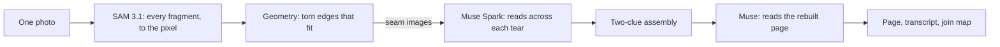

# Untorn

**Untorn is a project that puts torn documents back together from one photo, for archivists facing millions of hand-torn pages.** Meta's Segment Anything Model (SAM 3.1) cuts out every fragment to the pixel. Muse reads the half-letters across each tear, like a crossword, to decide which pieces belong together. When pages were torn as a stack, the pieces have identical outlines, so shape can't decide; reading does.

**Live:** https://untorn.vercel.app · **Demo video:** _(link added at submission)_ · **Verify it yourself:** [below](#verify-it-yourself)

Built for the Meta Global AI Developer Hackathon (Oct 26 – Nov 4, 2026).

## Why
In 1989–90 the Stasi tore its files apart by hand. About 16,000 sacks of scraps were saved, and some 15,400 are still untouched. A federal computer project rebuilt 23 of 400 contracted sacks before it was ended in 2023, and Germany's federal auditors put the finish at about 847 years at the current pace. In a 2023 market survey, no vendor could offer a system that already did this job in production. Sources: [`docs/FACTS.md`](docs/FACTS.md).

Shape matching alone fails where scraps share the same rupture edges (Diem, TU Wien, 2014), which is what happens when a stack is torn at once. Untorn adds the clue that geometry lacks: it reads.

## How it works

- **SAM 3.1** segments every piece in one call: a low-resolution pass finds the pieces, then each outline is snapped at full resolution.
- **Geometry** (deterministic TypeScript, `src/lib/rejoin`) traces subpixel outlines, separates straight page edges from torn ones, and fits torn edges together.
- **Muse Spark** looks at the rendered seam and reads across it: do the half-letters complete each other, and do the words continue? When several pieces share one outline, Muse picks the one that reads.
- **The two-clue rule:** a join is accepted only when the edges fit AND the words continue. Untorn never forces a join; unplaced pieces stay unplaced.
- **Muse** transcribes the rebuilt page, marks gaps as `[…]` and never fills them in.

More: [`docs/SOLVER.md`](docs/SOLVER.md) · [`docs/MODELS.md`](docs/MODELS.md) · [`docs/API.md`](docs/API.md) · [`docs/THREAT_MODEL.md`](docs/THREAT_MODEL.md)

## Measured
All numbers below are on **simulated tears of real public-domain pages**, scored against known answers. Real hand-torn paper is being tested next and will be reported separately.

| What | Result |
|---|---|
| SAM 3.1 segmentation, 10-piece photo (2400×1800 and 4800×3600) | 10/10 pieces; mean IoU 0.987–0.995; median edge error 0.42–0.65 px; one SAM call, 2–6 s |
| SAM 3.1 segmentation, 30-piece stack (4000×3000) | 30/30 pieces; median edge error 0.52 px |
| Solver, single pages, 8–12 pieces, geometry only (24 held-out cases) | 97.2% of pieces placed correctly (212/218); 0 misplaced; join precision 100% |
| Solver, 26–38 pieces (8 cases) | 100% placed (271/271) |
| Solver, mixed bags of 2–3 pages | 99.4% placed |
| Stack tears (identical outlines), geometry only | Every twin flagged; 0 misplaced (it waits for reading) |
| Stack tears, with a reading clue that is right 90% of the time | 92.2% placed; 0 misplaced |
| Muse Spark reading across seams (binary: same place or not) | 23 of 24 correct |
| Muse Spark choosing the true twin among identical outlines | 12 of 12 |
| Pixel appearance alone choosing the twin (no reading) | 48% (chance is 33%) |
| Full live run on the sample letter (production) | 10/10 pieces, 17/17 joins, about 36–44 s, about $0.15 |

## Verify it yourself
1. Open https://untorn.vercel.app. The first screen replays a recorded run of the real pipeline; press **Run it live** to send the same photo through it again.
2. **Tear your own:** tear a printed page into 6–12 pieces, lay them text-side up on something dark, scan the QR code with your phone and take one photo from above.
3. Every result has a **join map**: for each seam you see the edge fit and the exact image Muse read, with its answer and reason.

## Run locally
```bash
pnpm install
cp .env.example .env.local   # add MODEL_API_KEY (Meta Model API)
pnpm dev
```

## Built vs integrated
- **Built for this project:** the solver (outlines, edge matching, two-clue assembly), the two-pass segmentation, the seam renders and reading prompts, the streaming pipeline, the phone handoff, the app and its design, and the benchmark generator.
- **Integrated:**
  - Meta Model API (SAM 3.1, Muse Spark, Muse Wonder);
  - `@meta-sam/parser` (SAM License);
  - Next.js, `sharp`, Vercel Blob;
  - fonts: Gambetta (Fontshare), Schibsted Grotesk and IBM Plex Mono (OFL).

## What's live, and known limits
- **Live:** the full pipeline on uploads and phone photos, recorded-run replay, the join map, per-run links, a health check that rebuilds a known sample every hour, a daily spend cap.
- **Limits:**
  - Very large stacks can end with some twins unplaced, because reading is capped per run.
  - Straight cuts (scissors, shredder strips) are weaker than hand tears.
  - Tilted photos, glare and overlapping pieces aren't detected yet.
  - Double-sided pieces use only the visible side.

## Pre-existing vs new this event
- **New this event (from kickoff, Oct 26, 2026):** all code in this repository.
- Untorn's idea, research and code date from Oct 27–28. The repository's other branches hold an earlier project from this event (Push, a CPR trainer), from which only the SAM 3.1 client and parser were carried over.

## Credits and licences
- Sample letters: public domain. Pierre Chouteau to Mary Louise Dalton, 1903, Missouri Historical Society, via DPLA and Wikimedia Commons. Other pages are listed in [`scripts/bench/PAGES.md`](scripts/bench/PAGES.md).
- The tears in the samples are simulated, and every sample is labelled as such in the app.
