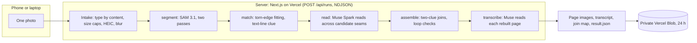

# Architecture

Untorn puts torn documents back together from one photo. This page maps the system: what runs where, which Meta model
does which job, and how a run moves from a photo to a rebuilt page. Detail lives in [`SOLVER.md`](SOLVER.md) (the
geometry), [`MODELS.md`](MODELS.md) (the model layer, measured), [`API.md`](API.md) (routes and events) and
[`THREAT_MODEL.md`](THREAT_MODEL.md) (uploads and privacy).

## One run

Every stage emits an event the moment it happens. The browser draws them live: the outlines as SAM returns them, each
read as Muse answers, the pieces flying home when the assembly lands. The same events, with their timing, are stored in
the run's `result.json`, so any run replays exactly (`/r/<runId>`), and the first screen is a recorded run of this
same pipeline, labelled as such.

## Who does what

| Step | Who | Why it is that one |
|---|---|---|
| Find every piece, to the pixel | **SAM 3.1** (Meta Model API, concept prompt "torn piece of paper") | One call outlines every fragment. A coarse pass at ~1280 px finds the pieces, then each outline is snapped at full resolution; median edge error 0.42 px on a 4800×3600 test photo. |
| Propose joins | **Deterministic TypeScript** (`src/lib/rejoin`) | Geometry should be exact and repeatable: subpixel outlines, torn vs straight edges, edge fitting, and the printed text lines as a second geometric clue (direction, pitch and phase must continue across a seam). |
| Confirm a join | **Muse Spark 1.3** | It reads the half-letters across a rendered seam: do they complete words, does the sentence continue? Where pieces share an identical outline (stack tears), it chooses the one that reads. |
| Read the page back | **Muse Spark** | Transcribes each rebuilt page, marking gaps as `[…]` and never filling them in. |

**The two-clue rule:** a join is accepted only when the edges fit and the words continue. A piece with no confident
fit is set aside, never forced.

## Where the code is

| Path | What |
|---|---|
| `src/lib/sam/` | SAM 3.1 request builders (concept, box and point prompts), response parser, mask decoder |
| `src/lib/server/segment.ts` | Two-pass segmentation; tiling for busy scenes |
| `src/lib/server/muse.ts`, `prompts.ts` | Muse calls with JSON-schema outputs: seam verification (binary), continuation choice (k-way), page reading; every prompt in one versioned file |
| `src/lib/server/hedge.ts` | Hedged requests: a second identical call starts when the first runs long; the model API has a long latency tail |
| `src/lib/server/pipeline.ts` | The live pipeline: stages, events, deadlines, costs |
| `src/lib/rejoin/` | The solver, pure TypeScript (runs in Node and the browser): `contour`, `edges`, `fragment`, `orientation`, `match`, `cuts`, `appearance`, `plan` (which questions to ask for stacks), `seam` (the images Muse reads), `assemble`, `render` |
| `src/lib/run/` | The run's types and events, replay, and the scene the hero draws (`scene.ts`) |
| `src/components/hero/` | The first screen: a canvas light table driven by the run's events, with the paper physics |
| `src/components/result/` | The rebuilt page, the transcript and the join map |
| `src/app/c/` | The phone capture page (QR handoff) |
| `scripts/bench/`, `scripts/eval/` | The benchmarks: simulated tears with known answers, the ShredBench protocol, the real-photo ground truth |

## Keeping it alive for a judge

- **Retries and hedges** on every model call, with jitter; the read stage has a deadline, and the assembly goes ahead
  with what was read (a warning says so).
- **Rate limit and spend cap:** live runs per IP per hour, and a daily model-spend cap across all runs. IPs are kept only
  as salted hashes (`src/lib/server/limits.ts`).
- **Health:** a cron rebuilds a fixed sample through the real pipeline and checks the join accuracy against its answer
  key; `GET /api/health` reports the last run.
- **Retention:** uploaded photos and runs are deleted within 24 hours by a cleanup cron.
- **Fallbacks:** the recorded runs replay without any model call, so the first screen never depends on the API.

## Cost and speed of one run

About $0.15 and 35–60 s for a 10-piece page on the live pipeline. Reading across seams is most of the time; SAM takes
about 4–7 s. Measured per stage in every `result.json` (`timings`, `cost`).
